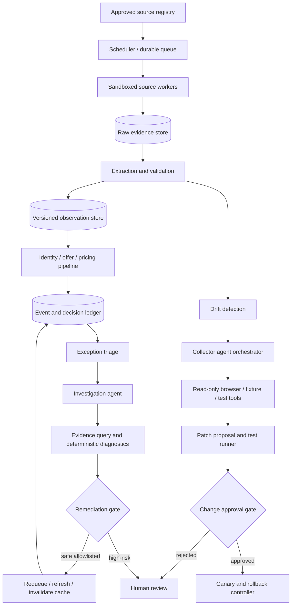

# Product–Engineering Manual: Competitor Onboarding, Collector Repair & Pricing Exception Investigation

**Version:** 1.0 — design proposal | **Operating model:** small ML/engineering team, limited operations | **Automation:** L2 bounded autonomy | **Status:** specification, in progress

## 0. Executive decision

Build **two bounded agent workflows on a shared evidence and execution platform**, not one unconstrained autonomous pricing agent:

1. **Competitor Onboarding & Collector Repair (COCR):** discover permitted source interfaces, propose extraction configurations, test against page fixtures, detect drift, and propose or safely deploy narrowly scoped repairs.
2. **Pricing Exception Investigator (PEI):** collect the causal evidence behind blocked, stale, incorrect, or anomalous pricing outcomes; classify root causes; propose remediation; execute only pre-approved reversible low-risk actions.

Neither agent has authority to modify final price, margin floors, product identity ground truth, commercial policy, or production publication approvals. Those remain under deterministic, versioned controls.

### Evidence provenance

Competitor onboarding was reported at **12 days**, with a proposed **3-day** target; collector data validation was described as taking up to **10 days**; large site-layout change MTTR was reported at **5 days** and ordinary changes at **3 days**; proposals included AI-assisted collector generation, headless-browser comparison, sample-based anomaly discovery, and repair.

**New recommendations in this manual:** service decomposition, typed tool permissions, data contracts, rollback gates, evaluation metrics, deployment architecture, and thresholds. Proposed numerical thresholds must be calibrated against country production data before release.

## 1. Business problem and success criteria

### 1.1 COCR problem

New competitor integration requires source investigation, API/DOM discovery, collector development, extraction normalization, operator validation, platform integration, and end-to-end testing. Site changes invalidate selectors or parsing assumptions and can silently corrupt prices, stock, product variants, or shipping information. Manual investigation and repairs scale roughly with source count and drift frequency, conflicting with a small team's operating model.

**Users:** pricing platform engineer, data/ML engineer, pricing operations reviewer, product manager.

**Jobs to be done:** onboard a supported competitor with known evidence of data correctness; detect when an existing collector is unhealthy; repair it without changing unrelated sources; prove extraction quality before enabling downstream use.

**Business outcomes:** time-to-first-valid-observation; median and P90 end-to-end onboarding lead time; collector availability; time to detect and recover from drift; operator hours per source-month; valid comparable-offer coverage. Do not equate the number of onboarded sites with commercial value.

### 1.2 PEI problem

Pricing failures can arise from upstream crawl failure, malformed extraction, stale observations, false product mappings, commercial ineligibility, shipping/promotion misinterpretation, pricing floor conflict, policy-version conflict, publication race, or failed read-back. Operators currently may need to traverse multiple tools, logs, and teams to identify the true cause. This delays recovery and increases manual burden.

**Users:** pricing operations reviewer, on-call engineer, product/brand manager, policy owner.

**Jobs to be done:** explain why an expected price was not published; identify the earliest failing stage; distinguish root cause from downstream symptoms; safely remediate routine incidents; escalate high-risk incidents with an evidence package.

**Business outcomes:** correct-root-cause rate; median and P90 time to diagnosis/resolution; proportion of eligible exceptions resolved without human intervention; recurrence rate; avoided wrong-price exposure; reviewer minutes per case. Do not optimize ticket closure count at the expense of correctness.

### 1.3 Non-goals for MVP

- Autonomous repricing or changes to financial guardrails.
- Circumvention of website access controls, authentication barriers, or anti-bot measures.
- Fully autonomous arbitrary code deployment or unreviewed dependency changes.
- Re-training foundation models on unverified operator feedback.
- Causal claims about conversion uplift without experiments.
- Building a generalized agent framework or microservice mesh before needed.

## 2. Product scope, requirements, and acceptance

| ID | Priority | Requirement | Acceptance evidence |
|---|---|---|---|
| COCR-01 | P0 | Source registry with ownership, access method, rate limit, scope and terms review | No collection job without approved source record |
| COCR-02 | P0 | Reproducible raw page/API fixtures and provenance | Every extracted observation links to immutable raw evidence |
| COCR-03 | P0 | Structured extraction of title, identifiers, variant, price, currency, availability, shipping/promotion evidence | Per-field quality report against labeled fixtures |
| COCR-04 | P0 | Automated validation of missing, malformed, inconsistent, and implausible fields | Invalid observations quarantined before pricing |
| COCR-05 | P0 | Site-drift detection and alerting | Detection and incident timestamps recorded |
| COCR-06 | P1 | Agent-generated configuration or code patch in isolated branch | Patch passes tests, diff limits, security scan |
| COCR-07 | P1 | Canary deployment and automatic rollback | No silent degradation after release |
| PEI-01 | P0 | Cross-stage correlation via trace and event IDs | One case reconstructs relevant source-to-publication lineage |
| PEI-02 | P0 | Root-cause taxonomy and evidence-backed diagnosis | Ground-truth case evaluation and abstention |
| PEI-03 | P0 | Safe read-only investigation tools | Tool access scoped by tenant, role, and case |
| PEI-04 | P0 | Human-review queue with actionable evidence and owner | Reviewer can accept, reject, correct and escalate |
| PEI-05 | P1 | Approved reversible remediation actions | Dry-run, idempotency, audit, rollback |
| PEI-06 | P1 | Recurrence clustering and defect backlog | Duplicate incident grouping with false-merge measurement |

## 3. Shared system architecture



**Deployability:** Start as one application with modular packages, Postgres, object storage, durable queue, and separate sandboxed workers. Split services only if security boundaries, workload isolation, or throughput require it.

### 3.1 Domain ownership

- **Source Registry:** source identity, supported access method, robots/terms/legal review status, credentials reference, rate limits, owner.
- **Collection:** fetch, snapshot, extraction, parsing, validation, provenance.
- **Identity and Offer:** external systems of record; neither agent silently edits verified mappings or offer rules.
- **Decision Ledger:** immutable linkage of observation, mapping, eligibility, price calculation, policy and publication events.
- **Agent Gateway:** model routing, prompts, tool permissions, budgets, traces and evaluation versions.
- **Review Console:** proposals, diffs, evidence, approvals, overrides, and reviewer labels.

### 3.2 Key invariants

1. An agent-generated result is a **proposal**, not ground truth.
2. An invalid or stale observation cannot authorize repricing.
3. Every consequential change has an owner, evidence, version, test result, and rollback route.
4. Model output never directly executes SQL, shell commands, price publication, or policy edits.
5. Source content is untrusted; page text cannot alter agent instructions or tool authority.
6. Each exception is linked to a specific pipeline stage and versioned input set.
7. No case may be silently closed solely because a model reports high confidence.

## 4. Data and API contracts

### 4.1 Source and observation

```json
{
  "source_id": "xy_competitor_001",
  "source_version": "adapter-17",
  "access_method": "public_html",
  "permission_status": "approved",
  "rate_limit_policy_id": "rl-001",
  "market": "xy",
  "owner_team": "pricing-platform"
}
```

```json
{
  "observation_id": "obs-uuid",
  "source_id": "xy_competitor_001",
  "listing_id": "listing-123",
  "raw_evidence_uri": "object://snapshots/immutable-key",
  "raw_evidence_hash": "sha256:...",
  "adapter_version": "adapter-17",
  "schema_version": "offer-observation-v1",
  "observed_at": "2026-10-13T09:00:00Z",
  "title": {"value": "Example product", "evidence_path": "jsonld.name", "status": "VERIFIED"},
  "price": {"amount": "1299.00", "currency": "USD", "evidence_path": "jsonld.offers.price", "status": "VERIFIED"},
  "availability": "IN_STOCK",
  "shipping": {"amount": null, "status": "UNKNOWN"},
  "validation_status": "PARTIAL",
  "errors": ["SHIPPING_UNKNOWN"]
}
```

Use decimal monetary values, explicit currency and tax basis, nullable unknowns, field-level provenance, and immutable snapshots. Never coerce missing shipping to zero.

### 4.2 Collector incident

```json
{
  "incident_id": "inc-uuid",
  "source_id": "xy_competitor_001",
  "adapter_version": "adapter-17",
  "detected_at": "2026-10-13T09:10:00Z",
  "symptoms": ["PRICE_PARSE_RATE_DROP"],
  "baseline_window": "7d",
  "current_window": "1h",
  "affected_fields": ["price"],
  "estimated_affected_listings": 84,
  "severity": "HIGH",
  "state": "TRIAGED"
}
```

### 4.3 Pricing exception

```json
{
  "case_id": "case-uuid",
  "sku_id": "SKU-001",
  "listing_id": "listing-123",
  "observation_id": "obs-uuid",
  "identity_assertion_id": "map-uuid",
  "eligibility_decision_id": "elig-uuid",
  "pricing_decision_id": "price-uuid",
  "publication_attempt_id": "pub-uuid",
  "policy_version": "xy-pricing-v5",
  "exception_type": "PRICE_NOT_UPDATED",
  "root_cause": null,
  "severity": "MEDIUM",
  "state": "OPEN"
}
```

### 4.4 Structured agent output

```json
{
  "case_id": "case-uuid",
  "agent_version": "pei-v1",
  "model_id": "provider/model/version",
  "decision": "PROPOSE_REMEDIATION",
  "root_cause_code": "STALE_COMPETITOR_OBSERVATION",
  "evidence_refs": ["obs-uuid", "event-uuid"],
  "alternative_hypotheses": ["SOURCE_FETCH_FAILURE"],
  "uncertainty": "LOW",
  "proposed_action": "REQUEUE_COLLECTION",
  "requires_approval": false,
  "explanation": "Latest verified observation exceeded the freshness policy.",
  "tool_trace_id": "trace-uuid"
}
```

All structured outputs are validated against strict schemas. Explanations cite recorded evidence; no hidden chain-of-thought collection is required.

## 5. Workflow A — Competitor onboarding

### 5.1 State machine

`REQUESTED -> SOURCE_APPROVED -> DISCOVERY -> FIXTURE_CAPTURED -> EXTRACTION_PROPOSED -> TESTING -> HUMAN_SIGNOFF -> CANARY -> ACTIVE`, with `BLOCKED`, `FAILED`, `ROLLED_BACK` terminal/exception paths.

### 5.2 Detailed workflow

1. **Intake:** register source, commercial priority, category coverage, allowed domains, legal/access review, and sample product URLs.
2. **Interface discovery:** prefer permitted feeds/APIs or structured data; inspect HTML only as needed; browser rendering is a fallback, not default.
3. **Fixture acquisition:** save representative raw pages/API responses with timestamps and hashes; include product variants, stock states, promotions, shipping cases, and missing fields.
4. **Baseline extraction:** deterministic parsers for JSON-LD and stable structured interfaces; rules/selectors for HTML.
5. **Agent-assisted proposal:** model suggests selectors, normalization transformations, or bounded parser changes using only approved tools and evidence.
6. **Automated tests:** schema, fixtures, field accuracy, negative cases, drift resilience, latency, cost, source limits, and security scans.
7. **Review:** show side-by-side raw evidence, expected fields, generated config diff, known limitations, and cost estimate.
8. **Canary:** deploy to small subset of pages; compare with frozen baseline and independently validated samples.
9. **Activation:** enable only after passing gates; retain rollback target and source-level kill switch.
10. **Maintenance:** periodic sampled QA, drift alarms, and change history.

### 5.3 Collector repair workflow

`ALERT -> CONFIRM_DRIFT -> CLASSIFY_CAUSE -> QUARANTINE_AFFECTED_FIELDS -> REPRODUCE -> PROPOSE_PATCH -> TEST -> APPROVE -> CANARY -> VERIFY -> CLOSE`.

Root causes: source outage; network/rate limit; access/permission change; API contract change; DOM change; localization/currency shift; variant-selection error; promotion rule change; source-side bad data; our parser regression. These require different remediations: a site outage should not cause the model to rewrite selectors.

### 5.4 Agent tools and permissions

| Tool | Access | Limits |
|---|---|---|
| `get_source_config` | Read | Approved source only |
| `fetch_approved_fixture` | Read | Sanitized immutable snapshot |
| `inspect_dom_structure` | Read | Sandboxed, domain allowlist |
| `compare_extractions` | Read | Two versioned runs |
| `propose_extraction_config` | Write proposal | Schema-constrained; no production mutation |
| `propose_patch_branch` | Write proposal | Isolated branch; file/path allowlist |
| `run_fixture_tests` | Execute tests | No network/production credentials |
| `request_canary` | Approval-gated | Separate deployment controller |
| `deploy_to_production` | **Denied to agent** | Authorized service only |

### 5.5 Repair safety

Prevent prompt injection through retrieved page text, dependency or secret exfiltration, arbitrary browser navigation, unsafe code generation, and regression on unaffected fields. Prefer config-only patches over generated executable code. Require human approval for new domains, authentication flows, changed dependencies, security-related changes, and untested code patches.

## 6. Workflow B — Pricing exception investigator

### 6.1 Exception taxonomy

- `SOURCE_UNAVAILABLE`, `EXTRACTION_INVALID`, `OBSERVATION_STALE`
- `PRODUCT_UNMAPPED`, `MAPPING_CONTRADICTION`, `MAPPING_DISPUTED`
- `OFFER_INCOMPARABLE`, `SHIPPING_UNKNOWN`, `PROMOTION_INELIGIBLE`
- `POLICY_BLOCK`, `MARGIN_FLOOR_CONFLICT`, `POLICY_VERSION_MISMATCH`
- `DECISION_SUPERSEDED`, `PUBLICATION_TIMEOUT`, `READBACK_MISMATCH`
- `UNKNOWN` (required abstention state)

### 6.2 Investigation state machine

`DETECTED -> CORRELATED -> EVIDENCE_COLLECTED -> DIAGNOSED -> [AUTO_REMEDIATION_ELIGIBLE | HUMAN_REVIEW | ABSTAIN] -> ACTIONED -> VERIFIED -> CLOSED`; reopen if verification fails or symptoms recur.

### 6.3 Diagnostic sequence

1. **Ingest trigger:** SLA breach, price mismatch, anomalous change, missing competitor reference, source alert, or reviewer report.
2. **Reconstruct lineage:** join source observation, identity assertion, commercial eligibility, pricing decision, publication attempt, and read-back by immutable IDs.
3. **Deterministic checks first:** freshness threshold, parser validity, mapping contradiction, policy version, margin floor, idempotency and publish status.
4. **Agent investigation:** when multiple plausible causes remain, retrieve bounded evidence and rank hypotheses with supporting and contradicting records.
5. **Action proposal:** classify fix as requeue, re-fetch, cache invalidation, mapping review, policy review, adapter repair, or incident escalation.
6. **Authorize:** only allowlisted reversible actions execute automatically; all other changes go to human approval.
7. **Verify:** re-run the relevant deterministic checks and confirm the original symptom resolved without new regressions.
8. **Learn:** store adjudicated root cause, effective action, recurrence, and operator feedback; do not treat model agreement as truth.

### 6.4 Example decision table

| Symptom | Evidence | Diagnosis | Allowed action |
|---|---|---|---|
| Price not updated | Valid recommendation, stale observation | Freshness block | Requeue approved collection |
| Unexpected cheap competitor | Different size/model in source evidence | Mapping contradiction | Quarantine mapping; review |
| Source price suddenly zero | HTML parser output missing currency and price | Extraction failure | Quarantine source observation; open repair |
| Price API returned success, storefront unchanged | Read-back mismatch | Publication inconsistency | Escalate; do not blindly republish |
| Price below floor | Floor rule triggered correctly | Business-policy block | Notify pricing owner; no override |

### 6.5 Tool permissions

Read-only: `get_case_timeline`, `get_observation_evidence`, `get_mapping_evidence`, `get_policy_decision`, `get_publication_attempt`, `get_readback`, `compare_prior_decisions`, `query_related_incidents`.

Bounded actions: `requeue_failed_collection` (deduplicated and rate-limited), `invalidate_non_authoritative_cache` (scoped), `open_review_case`, `attach_evidence`, `request_adapter_repair`.

Forbidden: change live prices, override floors, rewrite commercial policy, approve identity mapping, delete audit records, arbitrary SQL, or unrestricted shell execution.

## 7. LLM and agent engineering

### 7.1 Model selection by task

| Task | Default | Foundation model value | Escalation trigger |
|---|---|---|---|
| HTML/JSON-LD extraction | Deterministic | Generate proposed parser for novel layout | Stable parser unavailable |
| Page layout comparison | Structural diff | Explain semantically meaningful changes | Structural changes ambiguous |
| Collector repair | Config template | Propose constrained patch | Testable rule-based repair fails |
| Pricing lineage reconstruction | Deterministic joins | Summarize multi-stage causal evidence | Multiple hypotheses remain |
| Root cause | Rules and incident signatures | Rank ambiguous hypotheses | Low evidence completeness |
| Remediation authorization | Deterministic policy | None | Never delegated |
| Human explanation | Template | Concise evidence-linked summary | Complex multi-stage incident |

### 7.2 Agent execution pattern

Use a **bounded plan–tool–verify loop**: classify task -> choose allowlisted tools -> retrieve minimum evidence -> produce schema-valid proposal -> run deterministic verification -> route to authorization. Set maximum tool calls, token budget, wall-clock budget, retry budget, and allowed source paths. Exceeding any budget yields `ABSTAIN` or human escalation.

Do not require a multi-agent architecture initially. Compare a single tool-using model against deterministic baselines; add an independent verifier only where measured incremental quality exceeds latency and cost.

### 7.3 Prompt specification

System prompt must define: task scope; untrusted-source boundary; forbidden actions; requirement to cite evidence IDs; mandatory unknown/abstain behavior; structured JSON schema; prohibition on fabricating missing fields; no direct production changes. Version prompts and tool schemas. Use examples containing wrong source values, ambiguous variants, and adversarial webpage instructions.

### 7.4 Feedback and model lifecycle

Persist prompt/model/tool versions and trace IDs; collect human corrections with adjudication; maintain separate train/dev/test splits by **source and incident family** to avoid leakage; deploy new models only after offline regression, shadow evaluation, and canary. Prefer prompt/config improvements before fine-tuning; consider supervised fine-tuning only after sufficient verified, diverse cases. RLHF is not an MVP requirement.

## 8. Evaluation plan

### 8.1 Ground-truth construction

**COCR:** collect approved page fixtures spanning multiple sources, categories, variants, promotion types, site layouts, and known breakages. Label field values and source paths independently. Hold out entire sites/layout generations to test transfer. Include injected false prices and misleading page content.

**PEI:** create a corpus of historical incidents with full timelines, verified root cause, correct next action, action safety class, and actual resolution. Add synthetic fault-injection scenarios, but report synthetic and real-world performance separately. Use blind adjudication for disputed labels.

### 8.2 Metrics

| Product | Metric | Definition |
|---|---|---|
| COCR | Field precision/recall | Correct extracted fields vs verified field-level labels |
| COCR | Critical-field error rate | Incorrect price, currency, variant, availability, or eligibility-related fields |
| COCR | Drift detection recall / false alarm rate | True breakages detected / healthy sources falsely flagged |
| COCR | Repair success | Patch passes holdout fixtures and canary without regression |
| COCR | Onboarding lead time | Intake approval to first verified active observation |
| COCR | MTTR | Drift onset/detection to verified recovery; report both |
| PEI | Root-cause top-1 accuracy | Correct primary diagnosis on adjudicated cases |
| PEI | Unsafe-action rate | Disallowed or harmful actions proposed/executed |
| PEI | Verified resolution rate | Original incident resolved and read-back confirmed |
| PEI | Human time saved | Reviewer minutes vs baseline for comparable case mix |
| Both | Abstention quality | Accuracy on answered cases vs coverage and human workload |
| Both | Cost per successful case | Model + compute + review + rework costs |

### 8.3 Baselines and ablations

- **B0:** existing manual workflow.
- **B1:** deterministic validators, rule-based diagnostics, template extraction.
- **B2:** B1 + single LLM for ambiguous cases.
- **B3:** B2 + optional independent verifier for high-risk cases.
- **B4:** agent-proposed patch with automatic tests and bounded canary.

Ablate model reasoning, browser access, historical incidents, evidence provenance, and verification to quantify marginal value. Measure by site/category/severity, not only pooled averages.

### 8.4 Proposed release gates — to calibrate, not established facts

- **Safety:** zero unauthorized production writes in security and fault-injection tests; no live price/policy authority.
- **Collector:** zero known critical-field regressions in release fixtures; no unresolved critical canary discrepancies; statistically supported performance by source.
- **Investigator:** zero forbidden auto-remediations in test and shadow runs; approved actions demonstrate idempotency and verification; high-risk cases abstain.
- **Operations:** operator review volume fits staffed capacity; alerts have owners; rollback tested; measurable improvement over B1 in time or cost at non-inferior correctness.
- **Evaluation confidence:** use confidence intervals, incident-level deduplication, source-held-out testing, and a prespecified acceptable error budget. Never infer 99.9% safety from a small test sample with zero failures.

### 8.5 Online experiments

Run shadow-only diagnostics initially. For COCR, compare onboarding time and human effort using matched sources or staggered rollout; do not compare easy new sites against difficult historical sites. For PEI, randomize eligible low-risk exception cases between existing triage and agent-assisted triage, with consistent adjudication and guardrails. Measure re-open rates and downstream customer-price impacts. Stop on critical data corruption or unauthorized actions.

## 9. Infrastructure, security and operations

### 9.1 MVP infrastructure

- **Application:** Python service with modular COCR/PEI packages, typed interfaces and worker pool.
- **Persistence:** Postgres for registry, incidents, decisions, approvals, versions; object storage for immutable raw evidence and test artifacts.
- **Queues:** durable task queue with retries, dead-letter queue, idempotency keys, and per-source concurrency limits.
- **Browser:** isolated headless browser workers, domain allowlists, resource caps, no general outbound network from model tools.
- **LLM gateway:** provider-independent interface, structured outputs, caching where safe, request budget, observability and model fallback.
- **CI/CD:** fixture tests, code scanning, artifact signing where available, staged rollout, canary and rollback.
- **Observability:** OpenTelemetry-compatible traces, structured events, source health dashboard, token/cost ledger, incident alerts.
- **Secrets:** secret manager, least-privilege service accounts, separation of dev/staging/prod, audit retention policy.

### 9.2 Data protection and source compliance

Treat competitor pages, internal pricing, vendor terms, and incident data as confidential according to organizational policy. Minimize data sent to model providers, redact credentials/PII, configure retention appropriately, and restrict evidence access by role. Review permitted acquisition methods, applicable terms, and country legal requirements before collecting. Do not automate CAPTCHA bypass or unauthorized access.

### 9.3 Reliability design

Use exponential backoff with jitter, circuit breakers per source, content-hash deduplication, stale-observation quarantine, bounded retry budgets, and replayable event histories. Source failure should degrade to **no new pricing evidence**, not fabricated or last-known-as-current data. Agent downtime must not block deterministic pricing or rollback.

### 9.4 Suggested team ownership

- **PM / pricing domain owner:** outcomes, prioritization, policy signoff, risk thresholds.
- **Backend/platform engineer:** orchestration, schemas, registry, APIs, audit, CI/CD.
- **Data/ML engineer:** extraction evaluation, model gateway, agent prompts, drift detection.
- **Shared operator/reviewer (part-time):** gold labels, exception adjudication, high-risk approvals.

If only two engineers are available, sequence COCR foundation first, then PEI, while reusing the same case/evidence platform.

## 10. Milestones and deliverables

| Milestone | Deliverables | Exit condition |
|---|---|---|
| M0 — Baseline and taxonomy | Inventory of sources, incidents, lead times, gold-set protocol, risk register | Reproducible baseline and reviewed scope |
| M1 — Evidence foundation | Source registry, immutable snapshots, observation schemas, decision ledger, trace IDs | Reconstruct one end-to-end case without manual database forensics |
| M2 — Deterministic baselines | Extraction QA, drift checks, incident signatures, operator UI | Baseline metrics recorded on held-out fixtures |
| M3 — Collector agent | Config proposals, bounded browser inspection, test harness, diff review | Better time/cost than baseline without critical regressions |
| M4 — Repair canary | Alert-to-patch workflow, sandbox, approval, canary, rollback | Controlled repair proven on representative failures |
| M5 — Exception investigator | Case reconstruction, hypotheses, evidence-linked summaries, review routing | Correctness and reviewer-effort gains in shadow mode |
| M6 — Bounded L2 actions | Allowlisted requeues/cache invalidations, verification, audit | Safety gates and controlled online evaluation passed |

**Indicative sequence:** 0–2 weeks M0; 2–5 weeks M1/M2; 5–9 weeks M3/M4; 8–12 weeks M5/M6. These are planning estimates, not delivery commitments, and depend on access to existing source adapters, pricing events, and historical incidents.

## 11. Engineering backlog — first sprint

1. Define `Source`, `Observation`, `CollectorIncident`, `PricingException`, `AgentProposal`, `ReviewDecision`, and `ToolExecution` schemas with migrations.
2. Instrument source and pricing pipeline with correlation IDs and immutable event linkage.
3. Build fixture capture/replay and a field-level comparison test runner.
4. Implement deterministic source-health checks and stale-observation quarantine.
5. Create root-cause taxonomy and ten representative end-to-end incident fixtures.
6. Build agent gateway with strict JSON schema, deny-by-default tools, token/time budgets, and trace capture.
7. Add a minimal review screen for evidence, proposed action, approval, and rollback status.
8. Create CI checks for unauthorized tool calls, prompt injection, schema failures, and idempotent retries.

**Definition of done:** a reviewer can reproduce a failed extraction or pricing exception from stored evidence, see a bounded recommendation, inspect its evidence and tests, and reject it without any production side effect.

## 12. Architecture decision records

- **ADR-001:** Shared evidence platform, separate bounded agent workflows — accepted for MVP.
- **ADR-002:** Deterministic extraction/diagnostics before LLM — accepted for MVP.
- **ADR-003:** Config-first repair; code patches require isolated branch and approval — accepted for MVP.
- **ADR-004:** No model-controlled price publication, identity truth, or policy edits — accepted for MVP.
- **ADR-005:** No default dual-agent verifier; require ablation evidence — proposed.
- **ADR-006:** Modular monolith before microservices — proposed.
- **ADR-007:** Human feedback enters adjudicated dataset, not automatic online retraining — accepted for MVP.

## 13. Open decisions and required inputs

1. Which competitor sources are authorized and highest value? What data interfaces exist?
2. Can historical raw snapshots and site-layout incidents be retrieved, and under what retention constraints?
3. Which pricing stages expose stable event IDs and read-back evidence?
4. What is the observed breakdown of exceptions by root cause, severity, and resolution time?
5. Which low-risk actions can be safely allowlisted under current operational controls?
6. What are the available reviewer-hours/week and on-call arrangements?
7. What cloud/runtime/model-provider constraints and confidential-data policies apply?
8. What measurable economic value does each source add (coverage, actionable observations, competitiveness)?

## 14. Final recommendation

**Build the evidence foundation and deterministic baselines before introducing agents.** The first agent to production should be a *collector configuration and repair assistant* that produces tested proposals. The second should be a *read-only pricing exception investigator* that reconstructs causal evidence and reduces operator effort. Only after shadow and canary evaluation should either gain narrowly scoped reversible action rights. Success is measured by reliable competitor observations and shorter verified incident resolution—not by agent invocation count or automation percentage alone.
